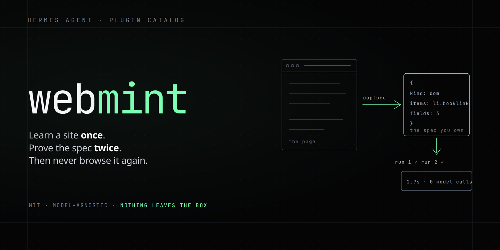

# webmint



**Turn a website into a deterministic, verified tool — using whatever model your agent already runs.**

No OpenAI key. No cloud. No sandbox. The artifact is a JSON file you own.

```bash
hermes plugins install DECRUX9812/webmint
```

That's it. The first mint provisions its own browser if needed; `webmint_setup` does it
explicitly if you'd rather pre-install.

---

## Why

Every agent demo ends the same way: it opens a browser, reads the screen, and guesses.
Tomorrow the page moves and the agent guesses differently.

webmint learns the page **once**, turns it into a declarative spec, proves the spec twice,
and then runs it as plain data — no model in the loop, ~3.5 s per call, same fields every time.

```
browser agent:  open browser → load → read pixels → parse → hope      (~31 s, shape varies)
webmint tool:   run_website_tool(query="...") → [{title, price}]      (~3.5 s, typed)
```

## What makes it different

| | |
|---|---|
| **Model-agnostic** | The mint calls the host's own `ctx.llm`. Whatever provider/model your agent is on does the work — DeepSeek, Gemini, a local model. Nothing is hardcoded to one vendor. |
| **Verified, not vibes** | A tool is saved only if it runs twice, returns rows both times, and every declared field is non-empty in most rows. A spec that returns 25 rows of `null` is rejected and repaired, not shipped. |
| **You own the artifact** | `tool.json` — readable, editable by hand, committable. No service holds your integrations. |
| **Read-only by design** | It reads pages. It does not submit forms, log in, or write. |

## Tools

| tool | what it does |
|---|---|
| `webmint_setup` | Check/provision Node, Playwright and Chromium (about 120 MB once). Idempotent. |
| `webmint_mint` | Capture a URL → the model writes a spec → run twice → save only if both runs agree |
| `webmint_run` | Execute a minted spec with new inputs (no model) |
| `webmint_list` | List minted tools with site, kind and verified state |
| `webmint_remove` | Delete a tool and its capture |

Ask your agent:

> Mint a tool for https://news.ycombinator.com/from?site=github.com that lists posts with title and url.

Then:

> Use it for rust-lang.org.

## Requirements

- **Node >= 18** — found automatically (`$WEBMINT_NODE`, `~/.local/node24/bin/node`, `PATH`,
  `/usr/local/bin`, `/usr/bin`; version checked).
- **Playwright + Chromium** — found in `$WEBMINT_PW_MODULES`, the plugin's own `node_modules`,
  an existing Pomerado install, or the global npm root. If none is present, `webmint_mint`
  provisions it automatically (set `WEBMINT_NO_AUTO_SETUP=1` to opt out).
- Everything else is stdlib Python.

## Artifact

```
$HERMES_HOME/webmint/tools/<name>/
├── tool.json     the spec (hand-editable; hand-written specs are first-class)
├── meta.json     provenance: model, runs, fill rates, timing, example input
└── capture/      the recording it was built from
```

A spec:

```json
{
  "name": "letterboxd_films",
  "kind": "dom",
  "url_template": "https://letterboxd.com/search/films/{query}/",
  "item_selector": "ul.results > li.search-result",
  "fields": {"title": "a.film-title", "year": "small.metadata a", "url": "a@href"},
  "input_schema": {"properties": {"query": {"type": "string"}}, "required": ["query"]},
  "limit": 20
}
```

Field expressions: `"css"`, `"css@attr"`, `"+ .x"` (next sibling), `"^ .x"` (parent) — the last
two exist because real pages split one record across sibling elements (arXiv's `<dt>`/`<dd>`).

`kind: "http"` replays a captured JSON endpoint instead (`method`, `headers`, `body_template`,
`items_path`, `field_paths`).

## Measured

Six tools, eight sites, minted with `deepseek-v4.1-flash` (2026-10-26):

| tool | mint | run | rows | field fill |
|---|---|---|---|---|
| wikipedia_search | 28.3 s | 3.1 s | 20 | 100% |
| arxiv_recent | 64.2 s *(1 repair)* | 2.7 s | 25 | 100% |
| github_trending | 29.5 s | 4.0 s | 14 | 93% lang |
| books_scrape | 15.4 s | 2.7 s | 19 | 100% |
| hn_github_posts | 18.8 s | 2.5 s | 30 | 100% |
| letterboxd_films | 32.4 s | 4.9 s | 20 | 100% |

mean mint **31.4 s** · mean run **3.5 s** · 6 of 8 sites mintable · break-even ≈ 10 runs

## Honest limits

- **Bot walls.** Headless Chromium gets 403 on some sites (Chewy, eBay) and an empty page on
  others (DuckDuckGo). Two of eight test sites failed this way. No prompt fixes a fingerprint —
  that needs your own browser profile, which is not in v0.1.
- **Read-only.** No writes, no logins, no forms.
- **Selectors rot.** `meta.json` records when a tool was verified; re-mint when a run starts
  returning zero rows. A repair cron is not included.
- **Weak models produce worse specs.** The verifier turns that into a visible failure rather
  than a silent one, which is the most that can be promised.

## Tests

```bash
python3 -m pytest tests/ -q     # 13 tests: validation, store, verifier gates, real browser fixtures
```

Two tests launch Chromium against a local HTML fixture — the extractor and the sibling
prefix are covered without touching the network.

## Credits

**Pomerado** — [github.com/Pomerado/pomerado](https://github.com/Pomerado/pomerado), MIT — made the case that a
website should be learned once and replayed instead of re-reasoned every run. webmint is an independent
implementation of that idea for Hermes Agent: the same shape (capture → spec → verify → tool), rebuilt so the
learning step runs on whatever model you already have, with the artifact as a JSON spec you own rather than
generated source. Their Guardian/authority model and job contract are worth reading; nothing is copied here.

**The conversation this came from** — @Gamma_950 ("your browser agent re-reasons every page on every run"),
@sreecharantwts ("browser use being slow and flaky is the real tax on agents"), @stretchcloud (structure loss in
markdown flattening), @pamelafox (WebMCP as the endgame). Those posts are the reason the pitch is about
verification, not speed.

## License

MIT © Ritesh Patel
